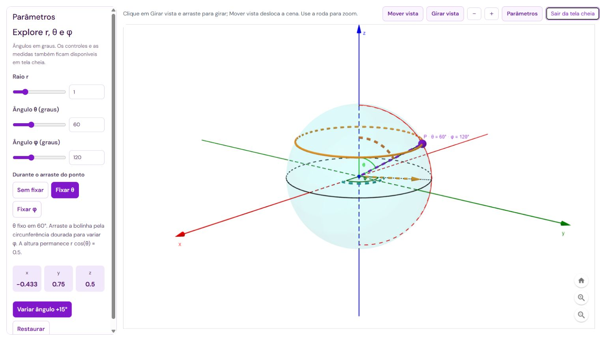
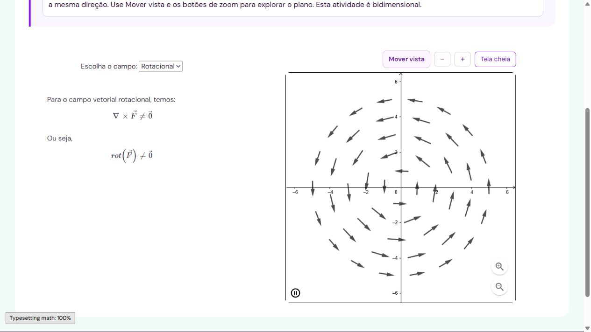
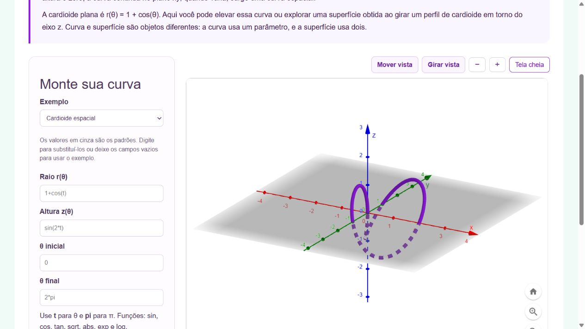

# Aula Interativa

Plataforma educacional para explorar **Álgebra Linear e Cálculo** com gráficos, animações e atividades interativas.

Esta versão reúne **34 atividades**, uma interface renovada e melhorias de navegação, preenchimento de parâmetros e enquadramento dos gráficos. O projeto continua em desenvolvimento.

## O que já está disponível

- Catálogo de atividades organizado em Álgebra Linear e Cálculo, com busca por assunto.
- Gráficos e construções interativas com GeoGebra, Three.js e Canvas, conforme a atividade.
- Textos introdutórios, exemplos e equações para acompanhar as explorações.
- Controles de zoom e tela cheia, com ajustes de tamanho nas atividades de Cálculo.
- Painel de parâmetros acessível na tela cheia, preservando os campos e controles das atividades.
- Coordenadas esféricas: raio e ângulos editáveis, com opção de fixar θ ou φ durante o arraste e acompanhar as medidas em tempo real.
- Coordenadas cilíndricas: explore a distância ao eixo, o ângulo e a altura mantendo duas coordenadas fixas.
- Campos separados para coordenadas de vetores e preenchimento direto de funções e parâmetros.
- Construções originais de Álgebra Linear preservadas, incluindo as animações de soma direta.
- Integração dupla por soma de Riemann com alteração das partições de x e y na tela cheia.
- Conchas de Raup, com parâmetros D, T e W, exemplos e equação de evolução por escala e rotação.
- Curvas polares em 3D: cardioides, espirais, rosáceas e uma superfície de revolução.
- Contador de visitas com mapa de origem aproximada e estimativa de sessões ativas.

## Atualização de 26/11/2026

A seção de Cálculo agora inclui coordenadas cilíndricas. Nas coordenadas esféricas, **θ é o ângulo medido a partir do eixo z positivo** e **φ é o ângulo no plano xy**:

- **Fixar θ:** arraste o ponto pela circunferência horizontal para variar φ; a altura permanece constante.
- **Fixar φ:** arraste o ponto pelo meridiano para variar θ.
- O painel mostra r, θ, φ e as coordenadas cartesianas do ponto, inclusive na tela cheia.
- Nas coordenadas cilíndricas, escolha **Variar φ**, **Variar z** ou **Variar r** para explorar uma coordenada de cada vez.

Para editar valores sem sair da visualização ampliada, use o botão **Parâmetros**. Ao sair da tela cheia, os controles retornam à posição original.

As conversões, as restrições dos ângulos, os polos e a origem têm testes automatizados. O arraste dos pontos e a edição de parâmetros também foram conferidos no navegador.

## Algumas telas

### Coordenadas esféricas: parâmetros na tela cheia



### Campo vetorial em movimento



### Curvas polares em 3D



## Possíveis implementações futuras

**Os recursos abaixo são planos para próximas versões e ainda não estão implementados.**

### Assistente de inteligência artificial

Um assistente para apoiar o estudo de Álgebra Linear e Cálculo, explicando conceitos, oferecendo dicas e desenvolvendo resoluções passo a passo. A proposta é que ele considere o assunto da atividade e, quando autorizado, as funções e os parâmetros escolhidos pelo aluno.

### Base de resoluções do professor e RAG

Organizar exercícios, resoluções e explicações revisadas pelo professor em uma base consultável. Com **RAG — Retrieval-Augmented Generation**, o assistente poderá buscar materiais relacionados à pergunta antes de elaborar a resposta, seguindo os métodos e a notação do professor.

O objetivo é apresentar referências ao material utilizado e distinguir uma resolução revisada de uma solução nova gerada pelo assistente. A inclusão de novos documentos atualizará a base de consulta, sem exigir um novo treinamento do modelo a cada atualização.

Também estão previstas a conferência de resultados com ferramentas de cálculo e a avaliação das respostas antes de disponibilizar o assistente aos alunos.

Veja o [planejamento das próximas etapas](docs/ROADMAP.md).

## Executar localmente

Requisitos:

- PHP 8 ou superior.
- Extensão PDO SQLite para o contador de visitas.
- Navegador com JavaScript habilitado. Algumas visualizações utilizam WebGL; as superfícies compatíveis possuem alternativa de renderização por Canvas.

Na pasta do projeto, execute:

```sh
php -S 127.0.0.1:8080 -t . tools/router.php
```

Depois, acesse **http://127.0.0.1:8080/**.

As bibliotecas principais já estão incluídas no repositório. Vídeos do YouTube, fontes externas e a identificação aproximada da origem dos visitantes dependem de acesso à internet.

O contador cria sua própria base SQLite fora da pasta pública, em `../work/site-data`. É possível definir outro diretório pela variável de ambiente `AULA_ANALYTICS_DATA_DIR`. Nenhum histórico de visitantes acompanha este repositório.

Este projeto utiliza PHP: o GitHub armazena o código, mas o GitHub Pages, sozinho, não executa o contador nem as páginas PHP. Para hospedar a aplicação completa, utilize um servidor com suporte a PHP e PDO SQLite.

## Verificação dos modelos matemáticos

Com Node.js instalado, os testes existentes das superfícies podem ser executados assim:

```sh
node tests/check-surface.cjs
node tests/check-raup.cjs
node tests/check-evolution.cjs
node tests/check-coordinates.cjs
```

## Organização

| Pasta | Conteúdo |
| --- | --- |
| Pastas das atividades | Páginas, construções e lógica de cada assunto |
| `css/` | Estilos compartilhados e ajustes de layout |
| `js/` | Navegação, integração dos gráficos, renderização e contador |
| `api/` | Registro e consulta das estatísticas de visita |
| `imagens/` | Ilustrações e miniaturas |
| `vendor/` | Bibliotecas e recursos de terceiros |
| `tests/` | Testes dos modelos matemáticos |
| `docs/` | Imagens e planejamento de evolução |

## Créditos

- Projeto do professor **Hector Carrion**, da Escola de Ciências e Tecnologia da UFRN.
- Desenvolvimento original por **Maciel Barbosa**: [repositório de origem](https://github.com/macielbarbosa/aulainterativa).
- Desenvolvimento e evolução desta versão por [**Luiz Felipe**](https://github.com/Luiz-OliveiraGomes).
- Os créditos dos demais desenvolvedores permanecem nas respectivas atividades, incluindo os links de autoria já existentes.

Referência do projeto: [Aula Interativa — ECT/UFRN](https://aulainterativa.ect.ufrn.br/).

GeoGebra, Three.js, MathJax, Bootstrap, jQuery e os demais componentes mantêm seus próprios termos e avisos de licença. As construções e os materiais educacionais conservam a autoria indicada em cada atividade.
